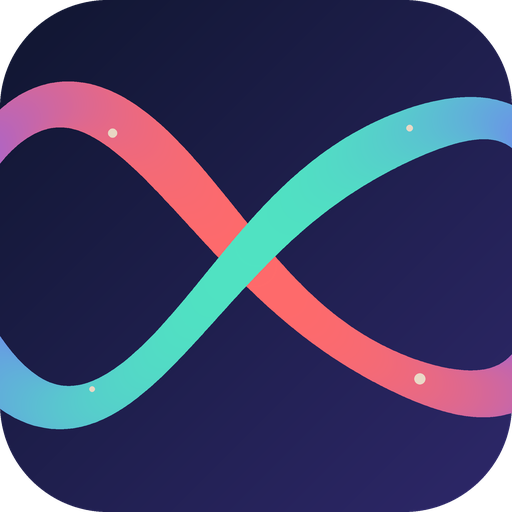
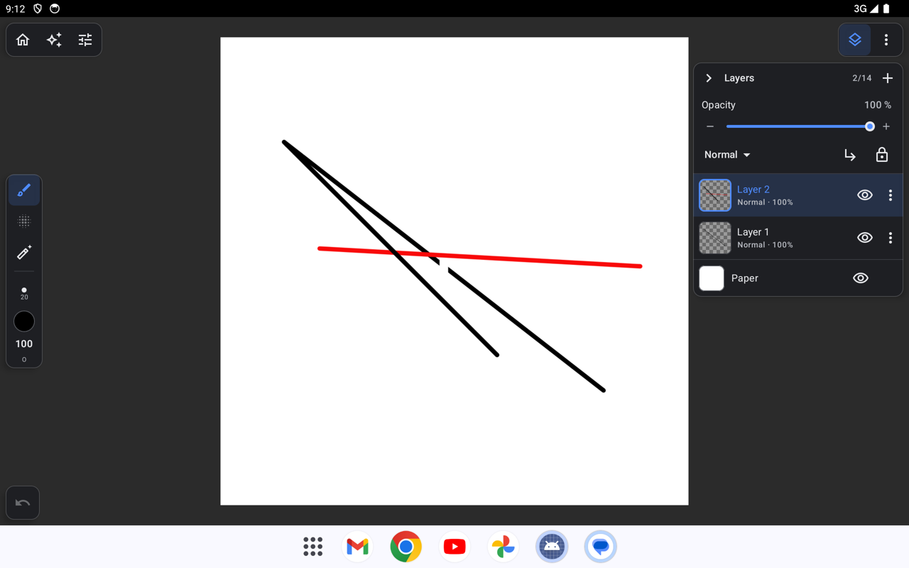
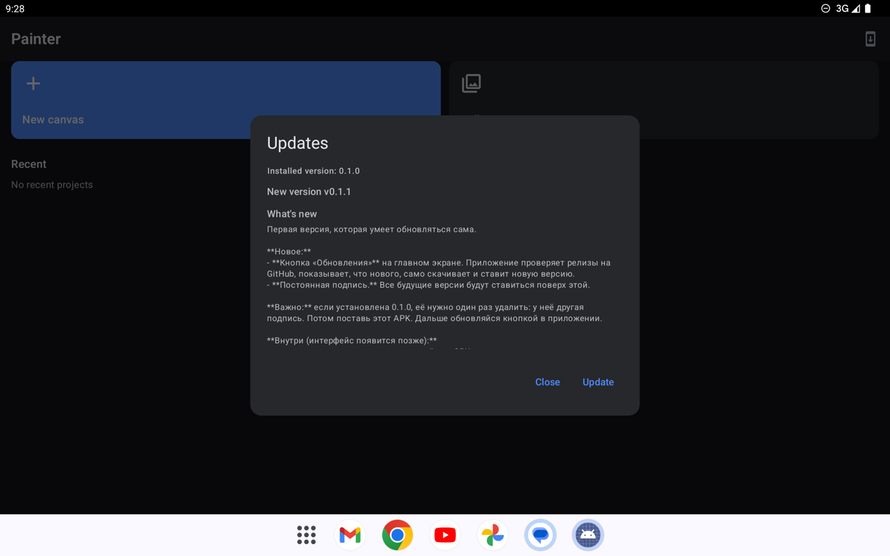

# Boundless Paint



Bitmap painting editor for Android tablets. The feature set is the union of Infinite Painter and ibisPaint; the interface follows the Infinite Painter scheme. The implementation is our own, from scratch, under clean-room rules ([00-clean-room/PROCESS.md](00-clean-room/PROCESS.md)).

The app is completely free: no subscriptions, ads, watermarks or paid features.

[](https://github.com/IWatman/Boundless-Paint/releases)
[](https://github.com/IWatman/Boundless-Paint/actions/workflows/ci.yml)


<p>
  
  
</p>

> **Status:** M5 (polish) is in progress (November 2026); M4 is complete. The app has the full brush engine (texture, paint mixing, watercolor, particles, harmony, 3D, filter and clone brushes), a catalog of 91 presets in 17 categories, the brush editor, stylus settings with calibration, layers with masks and adjustment layers, selections, transform, fills, gradients, symmetry, guides, perspective grids, shapes, filters, PSD in/out, timelapse, vector layers, frame animation and Google Drive backup.

## Features

**In the app**
- Canvases: screen sizes and print presets, project gallery (rename, copy, delete)
- Brushes: 91 presets in 17 categories (pencils, pens, markers, paints, watercolor, chalk, charcoal, airbrushes, textures, 3D, harmony, particles, manga, stamps, effects, outline, erasers); stylus pressure and tilt, velocity, stabilizer, point prediction, rejection of accidental stylus touches
- Brush editor: every engine parameter with a live preview; user brushes
- Stylus: pressure curve presets, per-device calibration wizard, pen buttons, eraser end, finger/palm rules
- Layers: groups, layer and group masks, all 33 blend modes, clipping, alpha lock, color tags, lock, reference layer
- Adjustment layers: curves, levels, gradient map, hue/saturation and others, non-destructive
- Selection: rectangle, ellipse, lasso, magic wand; invert, expand, feather; marching ants
- Transform: move, scale and rotate a layer or the selection, with a live preview
- Fill: bucket fill with gap closing and live recolor; gradients (linear, radial, symmetric, angular) with color stops, repeat/reflect, reverse and opacity
- Symmetry: mirror (vertical, horizontal, both), radial and kaleidoscope
- Guides: ruler, ellipse guide, lazy stroke; perspective grids (1, 2 and 3 points, isometric, 2D grid)
- Shapes: line, rectangle, ellipse, polygon, arc, drawn with the current brush; outline, fill, stamp
- Color: HSB wheel, sliders, hex, palette, eyedropper (long press)
- Undo and redo with buttons and gestures (two- and three-finger tap), two-finger navigation
- Filters: blur, motion blur, pixelate, sharpen, glow, noise, find edges, chromatic aberration, fisheye, dilate, erode, zoom and spin blur, radial lines, speed lines, halftone, outline, drop shadow, outer glow and panel grid (M3)
- More filters: smooth, lens blur, high-pass, frosted glass, grain, local contrast, bokeh, lens flare, god rays and cross filter (M5)
- Geometric filters: sphere lens, wave, ripple, twirl, polar coordinates, expansion, kaleidoscope, crystallize, hexagon and triangle pixelate, pointillize (M5)
- Stylization and material filters: gloom, sketch edges, trace, bevel, emboss, relief, satin, wet edge, waterdrop, extrude and clouds (M5)
- Artistic and generative filters: palette posterize, QR code, stained glass, dots, 1-bit stamp, glitch, retro game, chrome, sheer, impressionist, swirl painting and pop art (M5)
- Final M5 filters: manga and manga background tones, anime background, pencil sketch, oil paint, blur frame, table frame and rain (M5)
- Video timeline: converts frame animation to a 60 fps project with clip editing, playback and MP4 export at 720p/1080p (M5, slice 3)
- Pattern fill with twelve seamless procedural patterns (checks, dots, stripes, brick, herringbone, grain, zigzag, waves, triangles, stars, hexagons, wood grain), two colours, tile size, rotation, phase offset, contrast, invert and opacity (M5)
- Materials: eight procedural stamps - balloon, fabric, wood, metal, stone, foliage, sparkle and paper - with size, rotation and opacity (M5)
- Liquify and text stamp tools, hardware-keyboard shortcuts (M3)
- Canvas crop, canvas size with anchors, straighten; curvilinear 5-point perspective (M3)
- Brush import/export (`.pbrush`, `.pbrushes`, MyPaint, GIMP, Krita, Procreate, PNG/JPG) (M3)
- PSD raster-layer import/export and timelapse MP4 export (M3)
- Live filter layers and a five-point curvilinear perspective grid (M3)
- Rounded rectangle, arrow and speech-balloon shape tools (M4)
- Fill/erase selection and fill outside selection, direct lasso fill/erase (M4)
- Screentone, manuscript guides, radial/array rulers, CMYK TIFF, editable vector layers and frame animation with onion skin (M4)
- Google Drive backup: in-app Google sign-in, one archive per project in `Boundless Paint/Projects`, PNG saves in `Boundless Paint/Drawings`, optional auto-sync after every save, restore from Home or Settings; setup in [docs/google-drive.md](docs/google-drive.md) (M4)
- Unfinished brush-editor controls are disabled and marked with a small construction icon (M3.7)
- Autosave 2 seconds after a change, PNG/JPG export with quality and transparency options
- Share the finished drawing to any app through the Android share sheet
- In-app update from GitHub Releases

**Next (M5)**
- More pattern tools and the material library beyond the first stamp slice
- Video mode slices 4–5: audio, 4K/capability work
- Device performance and the real-tablet QA pass

Full plan: [spec/ROADMAP.md](spec/ROADMAP.md), the finished M2 plan: [spec/PLAN-M2.md](spec/PLAN-M2.md), known issues: [spec/STATUS.md](spec/STATUS.md).

## Installation

1. Download `boundless-paint-X.Y.Z.apk` from the [latest release](https://github.com/IWatman/Boundless-Paint/releases).
2. Open the file on the device and allow installation from this source. Android 10 or newer and OpenGL ES 3 support are required.
3. Further updates: the "Updates" button on the app's home screen.

> Releases from 0.1.1 on are signed with the same key and update each other in place. Version 0.1.0 used a different key: if it is installed, uninstall it once.

## Building from source

Windows, JDK 21 and the Android SDK (platform 34) are required. All other tools (Gradle, emulator, Python environment) live locally in the project folder, in `.tools/` and `.venv/`.

```powershell
. .\tools\env.ps1                                   # session environment variables
.\gradlew.bat :core:test                            # JVM tests of the core
.\gradlew.bat :app:assembleDebug                    # debug APK
.\gradlew.bat :app:connectedDebugAndroidTest        # GPU tests on a device or emulator
.\.venv\Scripts\python tools\gen_assets.py --check  # check the procedural brush assets
```

Releases are built by GitHub Actions: bump the default `appVersion` in `app/build.gradle.kts`, commit, then `git tag vX.Y.Z && git push origin vX.Y.Z`. The release workflow signs the APK with the key from the repository secrets and publishes it on GitHub Releases, where the in-app updater finds it. Local release builds read the key from `~/.painter/keystore.properties` (or the path in `PAINTER_KEYSTORE_PROPERTIES`); it never enters the repository.

## Project layout

| Module | What is inside |
|---|---|
| `core/` | Pure Kotlin, no Android. Document model, 256² tiles in half float, history, brush engine, blend modes, adjustments, selections, transforms, fills, guides, project format. Covered by JVM tests |
| `app/` | Android app: canvas on OpenGL ES 3 (layer compositing, masks, adjustments), input and gesture handling, UI on Jetpack Compose, updates |
| `.github/` | CI (unit tests and debug build on every push) and the release workflow (signed APK on a `v*` tag) |
| `tools/` | Environment, QA helper for the emulator, procedural asset generator and brush catalog (`tools/catalog`) |
| `features/` | Infinite Painter and ibisPaint functionality across 27 areas, described in our own words |
| `spec/` | Specifications: UI shell, feature map, decisions, brush engine, formats, tool specs by milestone |

Key decisions:
- **Raster:** brush dabs and raster operations are computed on the CPU in `core`, in parallel by tiles; the GPU handles compositing and previews. A dedicated test checks that GPU compositing matches the CPU reference.
- **Project format:** a folder with `manifest.json` and tiles in LZ4, export to `.pnt` (ZIP).
- **Assets:** all brush heads and textures are generated by code ([tools/gen_assets.py](tools/gen_assets.py)); there are no third-party images.

## Clean-room

The project reproduces the functionality of existing apps, but not their code or resources. Feature descriptions are gathered from public sources ([00-clean-room/SOURCES.md](00-clean-room/SOURCES.md)) and retold in our own words. Names, parameters, algorithms and assets are our own. Decompilation and copying are forbidden.
